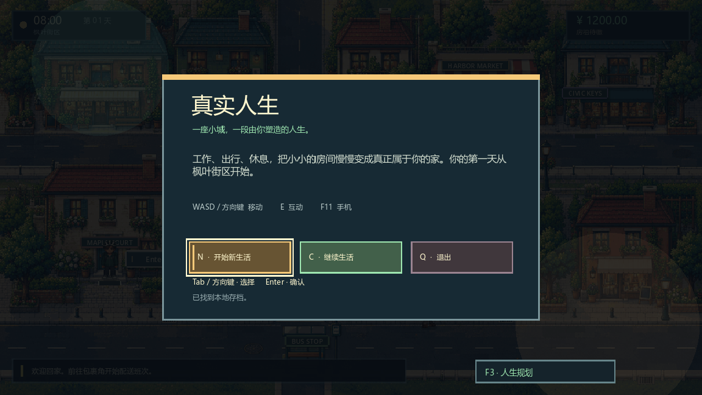
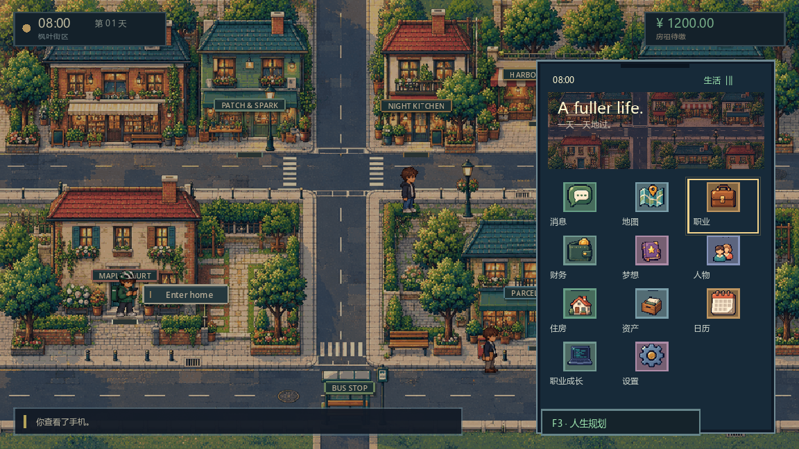
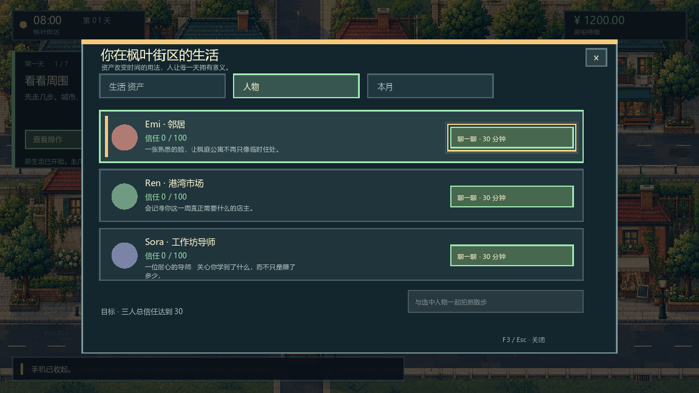

# REAL.LIFE：公开试玩 Beta

[English](README.md) | 简体中文

一款小而充实的现代像素风职业与生活沙盒 RPG。漫步 Maple Quarter，体验五种机制各异的职业，改善自己的家，使用载具和家电，建立人际关系，并保存持续发展的生活。

## 下载

打开[最新发布页](https://github.com/miasaka-mikoto/real-life-demo/releases/latest)，下载 Windows ZIP，解压后运行 `REAL.LIFE.exe`。当前公开版本为 **0.3.0-beta.1**，对应文件为 `REAL.LIFE-0.3.0-beta.1-Windows.zip`。

发布包包含 SHA-256 校验和、发布元数据、隐私说明、已知问题、试玩版许可及玩家反馈表。

## 试玩内容

- 五种职业与十五条路线；
- 可持续保存的紧凑城区，以及可以进入的家；
- 受现实条件约束的试玩版经济系统；
- 可实际使用的载具、家电、家具与职业资产；
- 与地点关联的人际关系及持久记忆；
- 昼夜、天气、像素动画与离线程序化音频；
- 键盘、鼠标及手柄导航；
- 英语 / 简体中文切换；
- 离线存档与继续游戏流程。

| 手机 | 人生规划 |
|---|---|
|  |  |

## 操作

| 操作 | 键盘 | 手柄 |
|---|---|---|
| 移动 | WASD / 方向键 | 左摇杆 / 方向键 |
| 交互 / 工作 / 确认 | E / Enter | A |
| 返回 | Esc | B |
| 手机 | F11 | X |
| 人生规划 | F3 | Y |
| 设置与语言 | F4 | Start |
| 首日引导 | F1 | Back / Select |

## 公开 Beta 状态

以下为该已发布 Windows 版本的既有验证记录，详见[公开发布说明](https://github.com/miasaka-mikoto/real-life-demo/releases/tag/v0.3.0-beta.1)。已通过的技术发布检查包括：

- Godot 4.7.2 静态检查 / 导入，以及 33 个标准测试入口；
- NVIDIA GeForce RTX 4060 Ti 上的双语渲染截图；
- 实体 XInput 设备检测与手柄操作路由；
- WASAPI 音频流、静音与音量余量检查；
- Windows x86_64 导出，以及原生无界面和可见窗口启动。

操作舒适度、趣味性、长时间游玩的平衡性和混音偏好仍通过公开 Beta 反馈收集，不预先标记为通过。可复现的 P0/P1 问题会阻止试玩版升级为后续稳定版。

## 反馈与问题报告

请在 [Issues](https://github.com/miasaka-mikoto/real-life-demo/issues) 中反馈，并提供：

1. `RELEASE_MANIFEST.json` 中的版本号；
2. Windows 版本、GPU 与输入设备；
3. 所选语言；
4. 使用新存档还是继续已有存档；
5. 首次出现的异常结果；
6. 截图、视频或可稳定复现的步骤。

- **P0：** 崩溃、数据丢失、无法启动或继续游戏
- **P1：** 正常游玩路线受阻、严重输入 / 界面故障、严重漏洞利用
- **P2：** 细节打磨、表述不清、轻微画面 / 音频问题

## 配置要求

Beta 阶段的暂定目标：

- Windows 10/11 64 位；
- 支持 OpenGL 3.3 / Godot Compatibility 渲染模式的 GPU；
- 约 500 MB 可用存储空间。

既有验证环境：Windows 11、NVIDIA GeForce RTX 4060 Ti、OpenGL Compatibility、WASAPI、XInput 手柄。

## 试玩版范围与已知限制

- 当前包含一个紧凑城区、五种职业及精选的生活片段，尚未覆盖完整的长期沙盒愿景。
- 游戏为单人离线体验，尚未实现多人游戏。
- 少量深入的职业详情仍可能显示英文；中文显示依赖已安装的系统字体回退，缺少中文字库的精简 Windows 环境可能出现替代字形。
- 预发行版本的存档可能无法迁移到未来版本。

更多说明见[已知问题](KNOWN_ISSUES.md)及[试玩版许可](DEMO_LICENSE.txt)。

## 隐私

默认离线运行，无需账号、付费 API 或 LLM 服务，也不包含广告或遥测。详见[隐私与离线行为](PRIVACY_AND_OFFLINE.md)。

## 仓库范围

本公开仓库仅用于**下载、截图展示与反馈跟踪**。开发源码仓库保持私有。

试玩版按 [REAL.LIFE 公开试玩版许可](DEMO_LICENSE.txt) 分发。允许发布游戏视频、截图、评测与非商业评论。
